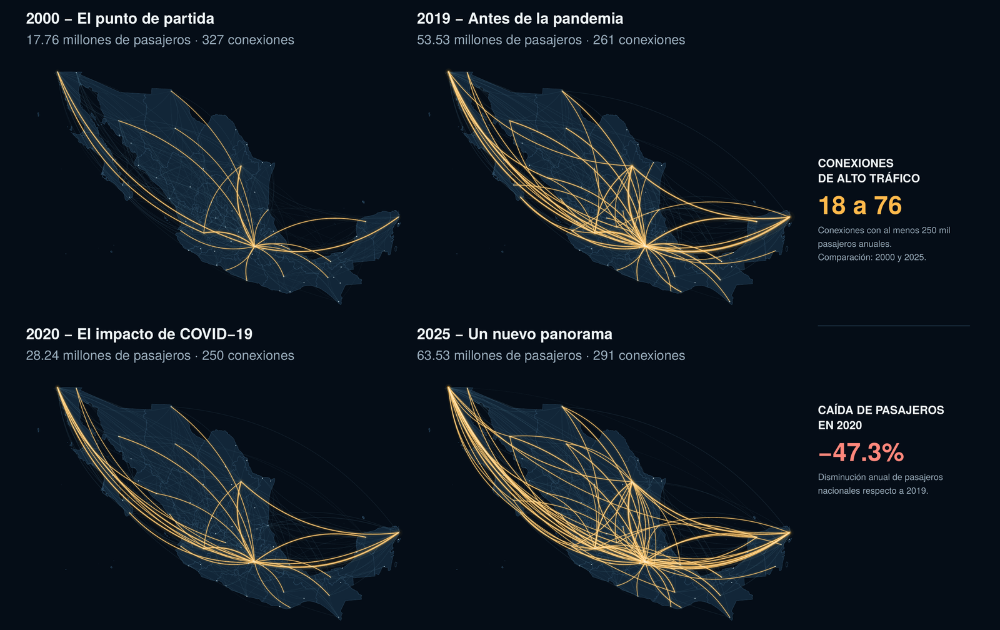

# México desde el aire

A poster I made in R for my Time Series course (Actuarial Science, Faculty of Sciences, UNAM). It covers 26 years of scheduled domestic flights in Mexico, from January 2000 to December 2025: how the route network grew, how hard COVID-19 hit it and how it recovered.



The full poster is in [`poster.pdf`](poster.pdf) (A1 size, text in Spanish).

## What the poster shows

- **Four maps** (2000, 2019, 2020 and 2025) with the domestic connections that carried passengers that year. Line width grows with the number of passengers, and connections with at least 250,000 passengers a year are highlighted in gold.
- **Monthly passengers and flights** for the whole period, with a 12-month moving average to show the trend behind the seasonal ups and downs.
- **Two key figures:** high-traffic connections went from 18 in 2000 to 76 in 2025, and passengers fell 47.3% in 2020 compared with 2019.

Overall, domestic passengers went from 17.76 million in 2000 to 63.53 million in 2025.

## How I built it

The data come from AFAC (Mexico's civil aviation agency), which publishes one Excel workbook per year. I kept only the scheduled domestic service sheets and combined the 26 years into a single monthly origin-destination table with 169,116 rows. That table is in `data/`, and the code starts from it.

The code runs in three steps:

1. `R/01_prepare_data.R` builds the monthly and annual totals, the moving averages and the route network. Each AFAC place name is matched to an airport with coordinates. Some cities changed airports during these years, so the catalog records which airport applies in each year. A→B and B→A traffic is counted as a single connection. The script also checks that no passengers are lost along the way and that the totals match the poster.
2. `R/02_plot_functions.R` draws the maps with `sf`, using an Albers projection and curved lines for the connections. It also draws the time series with `ggplot2`.
3. `R/03_build_poster.R` arranges everything with `patchwork` and saves the PDF.

The curves on the maps are schematic. They show which cities are connected, not the actual flight paths.

## How to reproduce it

You need R 4.5 (I used 4.5.1 on macOS). The R packages are `dplyr`, `ggplot2`, `patchwork` and `sf`. On macOS and Windows, `sf` installs from CRAN with everything it needs. On Linux, it also needs the GDAL, GEOS and PROJ system libraries.

```sh
git clone https://github.com/ManuelRazoAlc/mexico-air-traffic-time-series.git
cd mexico-air-traffic-time-series
Rscript install_packages.R   # first time only
Rscript make_poster.R
```

`install_packages.R` installs the package versions listed in `renv.lock` into a folder inside the project, so your other R packages stay untouched. `make_poster.R` creates `poster.pdf` in under a minute. In RStudio, you can open `mexico-air-traffic-time-series.Rproj` and run both scripts with `source()`.

On Linux, if the CSV files fail to load, run R with a UTF-8 locale (for example, `LC_ALL=C.UTF-8`).

## Data sources

- **AFAC**, [monthly traffic statistics](https://www.gob.mx/afac/acciones-y-programas/estadistica-mensual-operativa-monthly-traffic-statistics): scheduled domestic service, 2000–2025 → `data/afac_domestic_od_monthly_2000_2025.csv`
- **INEGI**, [state boundaries](https://gaia.inegi.org.mx/wscatgeo/geo/mgee) → `data/inegi_states.geojson`
- **DOF** [aerodrome coordinates](https://dof.gob.mx/normasOficiales/8006/sct11_C/sct11_C.html) and [OurAirports](https://ourairports.com/data/) → `data/airport_catalog.csv`. The catalog lists the source of each match and notes on ambiguous cases.

---

Manuel Razo Alcántara · [LinkedIn](https://www.linkedin.com/in/manuel-razo-alcantara) · Code under the [MIT License](LICENSE)
